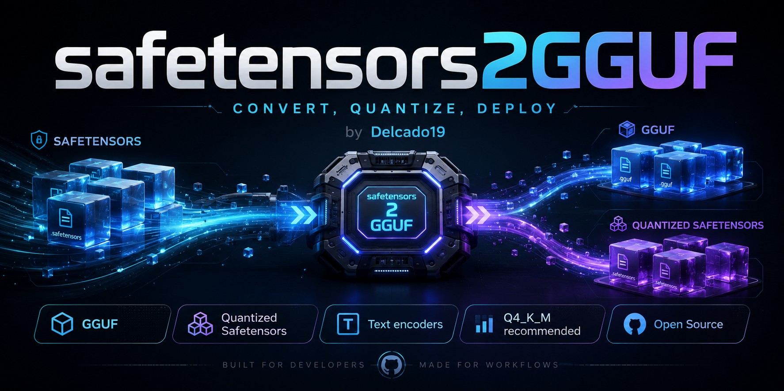

# safetensors2GGUF

> **Research branch WIP, resumed 2026-10-19:** multi-model/VL integration is
> under development. New original-key companion loaders remain unqualified for
> complete-model inference. See [CONTINUE.md](CONTINUE.md) for current validation
> and the [adapter contract](docs/extended-adapter-validation.md) for loader limits.

Complete CLIP-L/bigG, Qwen3-VL-4B and BigLoveEryn1 ERNIE original-key Q4_K_M exports
now pass real native ComfyUI CPU model construction through the companion loaders
(ERNIE uses BF16 CPU weights).
This is loading evidence, not inference/render qualification; see the
[complete-checkpoint validation](docs/companion-loader-validation.md).
The same ERNIE checkpoint also passes normal native CPU loading as INT8 Mixed
Safetensors (8.22 GB versus 16.07 GB, protected tensors unchanged); image inference
for this output remains untested.

Converts Safetensors / CKPT diffusion model checkpoints to **GGUF** for use with
**llama.cpp** and **ComfyUI-GGUF**, or to a quantized **Safetensors** file that
ComfyUI can load natively without the GGUF loader node. Also converts bare
single-file **text-encoder** checkpoints (Qwen3, T5/UMT5, Mistral, …) to GGUF
or quantized safetensors.

- **GGUF output** — direct Python quantization (F32 / F16 / BF16 / Q8_0) and
  K-quant quantization via a bundled `llama-quantize` binary (Q6_K, Q5_K_M,
  Q4_K_M, Q4_K_S, Q3_K_M, Q2_K).
- **Safetensors output** — F16, scaled FP8, ComfyUI-compatible tensor-wise
  INT8 (ConvRot-rotated where possible), and NVFP4, each with a "mixed"
  variant that preserves critical layers at their source precision.
- **Format guide** ? compatibility tables with model search and evidence filters;
  select a cell to review details, then use **Use format** to prepare a conversion.
- **Text-encoder → GGUF** — converts bare text-encoder checkpoints that lack
  `config.json`/tokenizer files, using a base model's HuggingFace repo ID; runs
  using the shipped pinned converter sources and a separate CPU quantizer.

A React workbench with file browser, format selection, live size estimates,
and cancellation is included for all conversion pipelines.

The planned shared conversion core is documented in the
[unified converter source inventory](docs/converter-consolidation-inventory.md).
The native conversion backends remain the default. Experimental Python Q6_K/Q5_K_M
is available explicitly for FLUX safetensors sources: select **Q6_K** or **Q5_K_M**, open
**Advanced settings**, and choose **Python - FLUX only (experimental)** under
**GGUF converter**. It uses the existing F16 preparation stage and needs no
external quantizer. Its current full-model evidence covers one klein Base 9B
checkpoint; other models/presets keep their established backends.
See the [policy comparison](docs/converter-policy-comparison.md) for measured
tensor-selection differences and the installed-model header audit.
The first [shared Q6_K mathematical pilot](docs/shared-q6-pilot.md) now reproduces
the native reference bytes on synthetic vectors, small installed-weight slices
and three complete streamed matrices. These remain research checks; raw tensor
artifacts do not add a production model conversion path.
The same payloads also survive a research GGUF container roundtrip; that mixed
test container is not a loadable model.
An explicit [FLUX Q6_K research file path](docs/flux-q6-research-path.md) also
matches the patched native quantizer on schematic files. The experimental
Workbench/API option uses that path; default conversions keep the existing backends.
The [full FLUX.2 klein Base 9B numeric comparison](docs/flux-q6-full-model-validation.md)
also matches all 201 native tensor payloads/types/shapes. A user-generated PNG
comparison confirms inference with two LoRAs for this checkpoint; the guide
records exact settings, visual differences and remaining validation limits.

The next [shared Q5_K block pilot](docs/shared-q5-pilot.md) also matches three
native references on 166 inputs. Its separately validated FLUX Q5_K_M mixed
preset is now available through the experimental Python option; model-level
policies remain separate from block mathematics.

## Supported Architectures

| Architecture | Format |
|---|---|
| FLUX.1 | Diffusers |
| FLUX.2 (klein / Dev) | Diffusers (shares `flux` arch tag with Flux.1) |
| Stable Diffusion 3 | Diffusers |
| SDXL | Diffusers / Non-Diffusers |
| SD 1.x | Diffusers / Non-Diffusers |
| HiDream | Diffusers |
| HunyuanVideo | Diffusers |
| Wan | Diffusers |
| LTXV | Diffusers |
| Cosmos | Diffusers |
| AuraFlow | Diffusers |
| Lumina 2 | Diffusers |
| Z-Image (Turbo / Base) | Diffusers (shares `lumina2` arch tag) |
| Qwen-Image / Qwen-Image-Edit (incl. 2511) | Diffusers |
| ERNIE-Image | Safetensors only (`ernie_image`; GGUF unsupported) |
| Krea 2 | Safetensors only (`krea2`; GGUF unsupported) |

## Installation

### New React workbench (preview)

On Windows, double-click **`start_gui.bat`** to launch the workbench with UV
and open http://127.0.0.1:8765 once the server responds, avoiding a premature
browser load. Entry HTML is not cached across frontend rebuilds. The launcher opens an existing Workbench instance
when one is already running. If the frontend build is missing, it installs its
locked dependencies and builds it (Node.js/npm required once).
After frontend source updates, run `npm run build` in `frontend` to refresh it.

On Linux, run `sh ./start_gui.sh` from the repository, or use the script's absolute
path from another directory. It checks for `uv` and prints installation guidance
if missing; it does not install `uv` automatically. A missing frontend build also
requires Node.js/npm and is built with `npm ci` and `npm run build`. With an
existing build, Node/npm is not required. The server runs in the terminal at
http://127.0.0.1:8765; open that URL in your browser and press Ctrl+C to stop it.
Stop any existing Workbench on this port before starting another instance.
The Linux launcher uses the frozen dependency lock. A successful launcher does
not imply all conversion backends have been runtime-tested on Linux.

Startup checks cover `uv` and first-build Node/npm only (Windows checks `npm`;
the Linux launcher checks both `node` and `npm`). Conversion-specific prerequisites
are checked when that backend runs:

| Conversion path | Additional Linux prerequisites |
| --- | --- |
| Native safetensors and direct diffusion GGUF FP16/BF16/Q8_0 | No llama-quantize executable; Python dependencies are managed by uv |
| Diffusion GGUF K-quants | City96-patched `llama-quantize`; build with Git, CMake and a C++ compiler |
| Text-encoder GGUF float/Q8_0 | Shipped pinned converter sources and Python dependencies |
| Text-encoder GGUF K-quants | Shipped Windows x86_64 plain CPU executable; no compiler |
| Allowlisted Krea GGUF formats | Shipped pinned molbal Python backend; no separate C++ executable |

See [Building llama-quantize](docs/building-llama-quantize.md) for package installation,
the pinned diffusion patch recipe, binary location and `LLAMA_QUANTIZE_PATH`.
Patched diffusion and plain text-encoder executables are not interchangeable.

The local React/Vite/FastAPI workbench supports diffusion-model and text-encoder
GGUF/safetensors conversion, local file browsing, inspection, progress,
cancellation and session history. Choose **Model type ? Text encoder** for
encoder weights; its formats and advanced settings follow the separate encoder
backend. Known incompatible ComfyUI family/format combinations are rejected. Python dependencies and launch use **uv**:

```bash
uv sync --frozen
cd frontend
npm ci
npm run build
cd ..
uv run python web_api.py
```

Open http://127.0.0.1:8765. Node/npm is needed for the frontend build, not normal
operation. **View technical log** automatically follows new output. Scroll up to
read earlier lines without interruption; scroll back to the bottom to resume.
Reopening the log shows the latest output. **Extract & repair** provides SDXL VAE/CLIP export with automatic
normalized tensor hashing and optional reuse of identical local references,
diffusion extraction, GGUF pad-token repair and 5D restoration. Different or
unknown components are exported. A shipped registry recognizes the official
SDXL 1.0 VAE/CLIP-L/CLIP-G and their FP16/BF16 casts without local reference
files. Local matches alone do not certify stock provenance.
**Hugging Face** inspects model repositories, lets you select one checkpoint
folder, and downloads/merges its safetensors shards into one local file. Downloads
share job history/cancellation and use server-side `HF_TOKEN`,
`CODEX_HUGGINGFACE_API_KEY`, or a stored Hub login for restricted repositories.
Model inspection and completed Safetensors downloads check embedded Tekken
tokenizers for ERNIE/Ministral 3 3B and Mistral Small 3.2 24B. Missing or invalid
data exposes **Create repaired copy**: supply a local `tokenizer.json` or
`tekken.json` from the exact model repository. The new
`-tokenizer-fixed.safetensors` file preserves and verifies every weight byte;
existing files are never overwritten. No tokenizer is guessed or downloaded.
Checks validate structure and vocabulary size, not provenance or inference
quality. Other families and GGUF tokenizer contracts are not checked yet.
**Downloads → Civitai** accepts version IDs, version-specific model links, or
direct download links with `fileId`. Inspect first, select a safetensors/GGUF file,
then choose **Download / resume**. Partials survive cancellation, network errors
and server restarts. Retry the same file in the same folder to continue. Temporary
failures retry up to four total attempts with fresh signed links and alternating
`.red`/`.com` domains. A response ignoring Range is never appended. The complete
SHA256 must match before atomic publication; existing outputs need explicit
replacement. Failed checksum partials are retained: choose another folder for a
clean retry. Only HTTPS Civitai storage redirects and the observed, pinned
Civitai Cloudflare R2 account host are supported.
The download view provides write-only **Civitai API key** setup.
Select **API key**, **Environment variable**, or **Windows Credential Manager**
from **Choose credential source…**, then fill the field with the key or
freely chosen variable/generic credential name. The server reads only the selected
source. Direct API keys are masked; variable and vault entry names stay visible
so typing mistakes are easy to spot. The server stores the resolved key
for this session; missing references are rejected.
The password field clears after submitting without clearing the server credential.
**Clear session key** removes the override. Automatic fallback below remains
available, but does not restrict names entered in the source selector.
Enter a key for the current server session or
explicitly save it in Windows Credential Manager as a generic credential named
`safetensors2GGUF/Civitai`. Resolution order: session override, `CIVITAI_API_KEY`,
`CIVITAI_TOKEN`, `CODEX_CIVITAI_API_KEY`, then that Windows credential. The UI shows
only presence/source, never stored key values. Keys are not saved in browser
storage, job history or project files. Clearing the session override restores
the environment/stored key; it does not delete that credential. Other Windows
Vault entries are not enumerated; explicit vault mode reads only your chosen
generic entry. On other platforms use session/environment keys.
**Format guide** includes the interactive diffusion/text-encoder support matrix,
model search, evidence filters and visible compatibility explanations. Select a
cell to review it, then **Use format** to prepare a conversion. Known unsupported
combinations cannot be applied from the matrix. See
[Workbench scope and validation](docs/web-workbench.md).

The diffusion matrix includes selectable **INT4 + ConvRot / mixed precision**:
SDXL has visible drift in the tested RealVisXL checkpoint; ZIT has a scoped
successful still-life test. Other models remain untested.
Equal-width centered format columns scroll horizontally on compact displays.
INT4 cells can prepare a conversion without promoting untested model evidence.

The local file dialog offers a **Drive or location** dropdown with Windows drive
letters and Home/Downloads/Documents shortcuts, for both source and output
selection. Linux offers the filesystem root and common mounted-media locations.

The compact matrix places identifiers below model names, splits format/policy
headers into centered lines, and separates Z-Image Base/Turbo-profile and
full/pruned Mistral evidence. Pending integration is distinct from failed support.

Workbench format names are uppercase: **FP16**, **FP8 (E4M3)**, **INT8 + ConvRot**
and **NVFP4**. “Mixed precision” describes the tool's protected-weight policy,
not an extra bit width. Short grouped choices show details below the select.
The guide distinguishes INT8 ConvRot from native **INT4 + ConvRot W4A4**.
Internal/API keys and filenames retain
their existing spellings for compatibility.

Krea GGUF now uses the project-owned pinned molbal source. Inspect the source
to expose FP16/BF16/Q8_0/Q5_1/Q5_0/Q4_1/Q4_0, then choose explicitly. No
llama-quantize or upstream fetch is required for these exports. A Krea-capable
ComfyUI core and molbal loader are required. Q4_0 has a two-prompt render test
with visible drift versus one installed INT8 ConvRot checkpoint; other scopes
remain untested. See [runtime evidence](docs/krea2-render-validation.md) and
[adapter restrictions](docs/krea2-backend-preparation.md).

### Python environment

```bash
git clone https://github.com/Delcado19/safetensors2GGUF.git
cd safetensors2GGUF

# Install uv (https://docs.astral.sh/uv/) then:
uv sync
```

Dependencies are maintained in `pyproject.toml` and locked in `uv.lock`.
This project does not maintain a separate `requirements.txt`.

<details>
<summary>Using pip instead</summary>

```bash
pip install gguf torch safetensors tqdm fastapi uvicorn huggingface_hub transformers sentencepiece protobuf
```

</details>

`uv sync` installs the Python dependencies. On Windows x86_64:

- **Diffusion GGUF K-quants** can use the bundled CPU backend without an external
  executable. The separate **Native** option still uses a City96-patched
  `llama-quantize`; see [llama-quantize Sources](#llama-quantize-sources).
  F32/F16/BF16/Q8_0 and native safetensors outputs retain their existing writers.
- **Text-encoder GGUF conversion** uses shipped pinned converter sources and a
  separate Windows x86_64 CPU quantizer. No Git, CMake or compiler is needed.
  Known base configurations/tokenizers are vendored; an explicitly entered
  non-vendored base repo may still require a config/tokenizer download.

## Output Safety

The conversion and GGUF repair paths write a temporary file next to the chosen
output and publish it only after successful completion. Cancellation, converter
errors, or write failures preserve an existing output. An empty output is
rejected even if an external converter exits successfully. Keep enough free space
for the new file while the previous output still exists. Source and destination
must be different files, including hard-link aliases.

All conversion tabs honor **Overwrite existing output** (off by default),
including the Text Encoder tab. Python callers of `run_quantize()` and the
`convert_text_encoder*()` functions must pass `overwrite=True` explicitly to
replace an existing output. External conversion processes can be cancelled
even while they produce no log output; network downloads, initial tool builds,
and individual tensor operations still finish their current blocking step.

## Quantization Levels

| Key | Bits | Backend | Notes |
|---|---|---|---|
| `F32` | 32 | Python | Full precision, largest |
| `F16` | 16 | Python | Half precision, standard default |
| `BF16` | 16 | Python | Brain float, best for BF16 source models |
| `Q8_0` | 8 | Python | Very high quality |
| `Q6_K` | 6 | llama-quantize | Very high quality |
| `Q5_K_M` | 5 | llama-quantize | High quality |
| `Q4_K_M` | 4 | llama-quantize | **Recommended** — good quality / size balance |
| `Q4_K_S` | 4 | llama-quantize | Good quality, smaller |
| `Q3_K_M` | 3 | llama-quantize | Moderate quality |
| `Q2_K` | 2 | llama-quantize | Smallest, lowest quality |

K-quants (marked *llama-quantize*) require a City96/ComfyUI-GGUF compatible
`llama-quantize` binary.  Upstream `ggml-org/llama.cpp` release binaries are
not selected automatically because they do not include the image-model patch
required for architectures such as Lumina 2.

The path is detected automatically from:
1. `LLAMA_QUANTIZE_PATH`
2. The ComfyUI Easy-Install bundled path:
`H:\ComfyUI-Easy-Install\Add-Ons\Tools\llama.cpp\llama-quantize.exe`
3. `COMFYUI_EASY_INSTALL_HOME` plus `Add-Ons\Tools\llama.cpp\llama-quantize.exe`
4. The system `PATH`

If no compatible binary is found, use the **Browse** button in the **Advanced**
section and select the `llama-quantize` executable.  The path field is
read-only on purpose, so users do not have to type or escape Windows paths.

### llama-quantize Sources

Recommended sources:

| OS | Source |
|---|---|
| Windows | ComfyUI Easy-Install bundled `Add-Ons\Tools\llama.cpp\llama-quantize.exe` |
| macOS / Linux | Build `llama-quantize` from `city96/ComfyUI-GGUF` using `tools/lcpp.patch` |

For a self-build (required on Linux/macOS, and on Windows without Easy-Install),
see **[docs/building-llama-quantize.md](docs/building-llama-quantize.md)** for
exact prerequisites and commands per OS — including a Visual Studio path and an
MSYS2/MinGW-w64 path that doesn't require installing Visual Studio at all.

The City96 patch is also a primary implementation reference, not only a build
step.  It documents how image GGUF architectures are registered in
`llama.cpp`, how `llama-quantize` should classify image-model tensors, and which
LLM-specific metadata assumptions must be bypassed for diffusion models.

## CLI Usage

```bash
# Convert to F16 GGUF (auto-detects output name)
uv run python convert.py --src model.safetensors

# Specify output path
uv run python convert.py --src model.safetensors --dst model-F16.gguf --overwrite
```

### Options

| Option | Description |
|---|---|
| `--src` | Source file (`.safetensors`, `.ckpt`, `.pt`, `.bin`, `.pth`) |
| `--dst` | Output GGUF path — auto-generated when omitted |
| `--overwrite` | Skip confirmation if output already exists |

### Fix Pad Tokens (Lumina 2 — existing GGUFs)

If ComfyUI raises *size mismatch for x_pad_token*, the GGUF was converted before
the shape fix was introduced.  Repair it with:

```bash
uv run python fix_pad_tokens.py --src model.gguf --dst model-fixed.gguf
```

| Option | Description |
|---|---|
| `--src` | Source GGUF (1D pad tokens) |
| `--dst` | Output GGUF path |
| `--overwrite` | Skip confirmation if output exists |

New conversions are unaffected — `convert.py` stores pad tokens as `[1, D]` automatically.

### SDXL Component Extraction

The **Extract Components** tab inspects SDXL checkpoints that bundle UNet, VAE,
CLIP-L, and CLIP-G in one `.safetensors` file.  It compares embedded components
with local standard references when present:

| Component | Embedded prefix | Local reference |
|---|---|---|
| VAE | `first_stage_model.*` | `models\vae\sdxlVAE.safetensors` |
| CLIP-L | `conditioner.embedders.0.*` | `models\clip\clip_l.safetensors` |
| CLIP-G | `conditioner.embedders.1.*` | `models\clip\clip_g.safetensors` |

After analysis, select the components to export.  VAE files are written to
`models\vae`; CLIP-L and CLIP-G files are written to `models\clip`.  CLIP-G is
converted from the embedded OpenCLIP key layout to the Comfy/HF key layout,
including Q/K/V split and `text_projection` transposition.

### 5D Tensor Post-processing (HunyuanVideo / Wan)

Qwen Image Edit 2511 also uses this companion-file workflow for its empty
`__index_timestep_zero__` variant marker. Native llama-quantize rejects empty
dimensions, so conversion exports the marker and Fix 5D Tensors restores it
after quantization. The GUI runs this step automatically; CLI users must use
the printed companion path with `--fix`, as in the example below.

The Web UI applies this automatically after llama-quantize — no manual step
needed there.  For manual CLI workflows:

```bash
# 1. Convert to F16
uv run python convert.py --src model.safetensors

# 2. Quantize with llama-quantize (external step)
llama-quantize.exe model-F16.gguf model-Q8_0.gguf Q8_0

# 3. Insert 5D tensors
uv run python fix_5d_tensors.py --src model-Q8_0.gguf --dst model-Q8_0-fixed.gguf --fix "path-to-sidecar-printed-by-convert.safetensors"
```

Each conversion writes its own `<output>.<job-id>.5d.safetensors` side-car,
containing only that conversion's tensors. Unique names also preserve the
companion of an earlier successful output when a replacement conversion fails.
When quantizing manually, pass the side-car from the first step explicitly
with `--fix`, as above. Auto-detection uses the basename recorded in GGUF
metadata first. Without that metadata it tries `<src>.5d.safetensors`, then
the legacy `fix_5d_tensors_<arch>.safetensors` name. The GUI passes the current
job's side-car explicitly and uses unique F16 intermediate filenames.

## Benchmarking llama-quantize

Use the benchmark helper to compare compatible `llama-quantize`
binaries on the same source GGUF:

```bash
uv run python tools/benchmark_llama_quantize.py \
  --src model-F16.gguf \
  --quant Q4_K_M \
  --threads 8 \
  --exe H:\ComfyUI-Easy-Install\Add-Ons\Tools\llama.cpp\llama-quantize.exe \
  --exe path\to\another\patched\llama-quantize.exe
```

The benchmark writes temporary output GGUFs and removes them after timing.  Use
an F16, BF16, F32, or Q8_0 source GGUF for meaningful measurements.

## Safetensors Output

The **Convert → Safetensors** tab in the Web UI produces quantized `.safetensors`
files as an alternative to GGUF.  This is useful
when you want ComfyUI-compatible weights without the GGUF container format.

| Key | Format | Backend | Notes |
|---|---|---|---|
| `F16` | Half precision | Python | Standard default, smallest non-quantized size |
| `F16_MIXED` | Half precision, protected tensors retain their dtype | Python | Preserves protected source tensors |
| `FP8` | Scaled float8_e4m3fn (ComfyUI convention) | Python | Full-precision compute by default (`full_precision_matrix_mult`) — see below |
| `FP8_MIXED` | FP8, protected tensors retain their dtype | Python | Same full-precision-compute default as `FP8` |
| `INT8` | int8_tensorwise, ConvRot-rotated where possible (ComfyUI convention) | Python | Per-layer `weight_scale`; native Kitchen kernels dynamically quantize activations |
| `INT8_MIXED` | INT8/ConvRot, protected tensors retain their dtype | Python | Aggressive 8-bit quantization with protection |
| `NVFP4` | NVIDIA FP4, block-scaled | Python | Full-precision compute by default (`full_precision_nvfp4`); needs a Blackwell GPU (RTX 50-series/B200) to run — see below |
| `NVFP4_MIXED` | NVFP4, protected tensors retain their dtype | Python | Same full-precision-compute default as `NVFP4` |

Already-quantized weights are reconstructed for quantization math. Mixed output
stores reconstructed protected weights as BF16; genuinely F32/F16/BF16 source
weights retain their dtype. This avoids expanding low-precision source weights
to F32 without recovering precision.

The **Mixed precision protection profile** selector distinguishes Qwen Image
Edit 2511 (automatically recognized by its checkpoint marker) from the broader
conservative Qwen policy. Only the first transformer block's image modulation
is protected in the 2511 profile. Z-Image Turbo requires explicit selection;
automatic selection retains the conservative Base-compatible policy because
both variants share architecture signatures. The Turbo profile remains experimental across formats: its NVFP4 output passed
two fixed-seed full-model renders, but the narrower FP8/INT8 policies have not
yet received equivalent full-model validation. Use conservative protection for
unknown variants.

Size estimates use the writer's source-aware plan, remove consumed quantization
sidecars, and include the effective reconstructed dtype. The UI shows quantized
weights, retained-precision weights and scale overhead, and flags savings below
5%. Estimates exclude the small JSON header. FP8 to INT8 still offers essentially
no storage saving: both store eight bits per weight. See
[the measured size audit](docs/quantization-size-audit.md).

Native **INT4 ConvRot** has also passed a full SDXL test with classic/dynamic
offload and LoRA: 2.00 GiB versus 4.78 GiB source UNet weights. This experimental
checkpoint was packed using installed Kitchen directly. **INT4 + ConvRot mixed
precision** is now a diffusion safetensors output choice. It requires a ComfyUI
loader with `convrot_w4a4` and Kitchen `TensorCoreConvRotW4A4Layout` (tested
Kitchen 0.2.36/0.2.37, ComfyUI 0.38.0); native INT4 compute needs NVIDIA SM 7.5+.
Older loaders are incompatible. The writer uses PyTorch only, preserving source
precision for protected, unaligned, non-Linear and shape-critical weights.
Its packed INT4 `[N,K/2]` and FP32 row-scale `[N]` contract is checked against
Kitchen using `scripts/check_int4_native.py` in a ComfyUI Python environment.
See [the validation report](docs/int4-convrot-validation.md) for
packing/version details and visible quantization differences.


**Naming vs. the community:** `FP8`/`FP8_MIXED` write files named
`<model>-fp8_e4m3fn_scaled(_mixed).safetensors` — the same "scaled fp8"
convention Civitai/Comfy-Org releases use, so you can tell at a glance it's
the same compression as a Civitai `fp8_e4m3fn_scaled` upload (this tool only
writes the e4m3fn variant, never e5m2). `NVFP4` is NVIDIA's own name and
**not** the same algorithm as **NF4** (bitsandbytes' 4-bit normalfloat, the
format behind Civitai's "Flux NF4" releases) — this tool does not offer NF4.

**Estimated output size:** once a source model is selected, the tab shows an
"Estimated output" size under the format dropdown, computed from the actual
safetensors header (no tensor data loaded) rather than a fixed ratio — needed
because `*_MIXED` formats' size depends on the detected architecture's
protected-tensor list, not just the target dtype.

**Per-architecture recommendation badge:** once a source model is selected,
the tab shows a colored hint under the format dropdown — analogous to the
GGUF tab's static "recommended ★" label on `Q4_K_M`, but per-architecture.
Unlike GGUF K-quants (a uniform quality/size tradeoff regardless of
architecture), plain `INT8` has measurably corrupted output (wrong
poses/identities) on attention-sensitive DiT architectures in this project's
own testing, while being fine on architectures with no protected layers at
all. The badge discloses confidence honestly: only Lumina2/Z-Image's
protection scope has been confirmed by an actual convert+load+render cycle;
other protected architectures show the same recommendation but note it's
matched against a community reference, not yet render-verified.

**ComfyUI version requirement:** loading `INT8`/`INT8_MIXED` output needs
**ComfyUI v0.25.0+** — `comfy-kitchen`'s int8/ConvRot optimizations landed in
`comfy-kitchen` 0.2.9 (commit `ade4dfd`), first bundled in ComfyUI v0.25.0
(2026-06-16). Older ComfyUI versions either won't have the `int8_tensorwise`
loader at all or will use an unoptimized/pre-ConvRot version of it.

**Why FP8 is safe now, and why NVFP4/MXFP8 still aren't offered:** ComfyUI's
native FP8/NVFP4/MXFP8 formats dynamically quantize *activations* too at
inference time (`QUANT_ALGOS["quantize_input"]` defaults `True`), which
produced visibly wrong output (black bars, wrong poses/identities, full-image
noise) on Lumina2/Z-Image checkpoints even after this tool's own on-disk data
was verified byte-correct — activation quantization is inherently lossy in a
way no weight-side protection list can compensate for. ComfyUI marks
`int8_tensorwise` with `"quantize_input": False`
— this skips the ComfyUI input wrapper, but Kitchen's native INT8 kernel still
quantizes activations dynamically. It does not guarantee full-precision
activations. See [docs/quantization-size-audit.md](docs/quantization-size-audit.md)
for the source-aware size findings and runtime checks, and
[docs/issues_analysis.md](docs/issues_analysis.md)
#15 (including its Correction note — an earlier draft of this investigation
misattributed the corruption to a specific ComfyUI GitHub issue that turned
out to be a performance-only bug; that citation has been retracted).

FP8 turned out not to need this exclusion: `comfy/utils.py`'s
`convert_old_quants()` — the function ComfyUI uses to load the scaled-FP8
checkpoints already common on Civitai/HuggingFace — sets
`"full_precision_matrix_mult": true` for those legacy checkpoints, which makes
`comfy/ops.py`'s `MixedPrecisionOps.Linear.forward()` skip the risky
quantized-compute branch entirely and run a plain full-precision matmul
instead, architecture-independently. `convert_to_safetensors()` now writes
that same flag by default for every FP8/FP8_MIXED layer it produces
(`full_precision_fp8=True`), so this tool's own FP8 output *should* be as
safe as the checkpoints already circulating in the wild — no per-architecture
bet the way INT8's `keys_hiprec` is, for the runtime compute path. That
conclusion comes from reading ComfyUI's source, though, not from an actual
convert+load+render test with this tool's own output — so the Model Support
tab still shows FP8_MIXED as **? Unknown** on every architecture except
`lumina2` and `flux`. `lumina2`: a same-seed/prompt comparison confirmed
composition, identity, and outfit preserved (only a single secondary prop's
color/shape deviated, judged tolerable variance) — the same bar INT8_MIXED
already met, so `lumina2` + FP8_MIXED shows **✓ Verified** (see
`docs/issues_analysis.md` #16's third correction). `flux` (FLUX.2 Klein 9B):
3 same-seed/prompt comparisons (5 seeds total) showed zero visible deviation
from baseline for FP8, FP8_MIXED, INT8, *and* plain INT8 — a stronger result
than `lumina2`'s, so all four show **✓ Verified** there, unlike `lumina2`
where plain FP8/INT8 stayed on the ✗ side. `full_precision_matrix_mult` also only fixes the
*runtime* compute path — it does nothing for precision already lost when a
tensor is quantized to e4m3 *on disk*, so plain (non-mixed) FP8 carries the
same keys_hiprec sensitive-architecture risk plain INT8 does, and the
format-recommendation badge on Convert → Safetensors warns for it
identically. That risk is no longer just theoretical for `lumina2`: a
separate same-seed/prompt comparison showed plain FP8 output there with a
different outfit and background than the unquantized render (only the pose
skeleton matching) — the Model Support tab shows plain FP8 on `lumina2` as
**✗ Known issue**, not Caution (see #16's second correction). The tradeoff
on top of all that is no FP8
tensor-core compute speedup; FP8 output is a storage/VRAM-savings format
only unless a user explicitly opts out (`full_precision_fp8=False`). See
[docs/issues_analysis.md](docs/issues_analysis.md) #16 for the full
investigation. NVFP4 has a fix now too (2026-08-13): reading ComfyUI's
actual `comfy/ops.py` source found `full_precision_matrix_mult` is read
generically per-layer, not FP8-specific — `convert_to_safetensors()` now
sets it for `nvfp4` layers as well (`full_precision_nvfp4=True`). A first
`flux` render test with this alone still crashed ComfyUI outright
(`RuntimeError: mat1 and mat2 shapes cannot be multiplied`) — a second bug,
`ModelFlux.keys_shape_critical` missing `txt_in.weight`/
`vector_in.in_layer.weight`, the same #9 shape-inference class `img_in`
already guarded against. Both fixed, re-converted, re-rendered: `flux` +
NVFP4/NVFP4_MIXED now show **✓ Verified**, same bar FP8/INT8 already
cleared. `lumina2` was re-converted and re-tested with the same fix
(2026-08-13; its own `keys_shape_critical` was audited against ComfyUI's
Lumina2/Z-Image detection code and already covered every raw shape read
there, so no `flux`-style gap existed to fix) — no more full-image noise on
any of 3 tested prompts, but one of the three still showed a full
composition/pose/outfit change from baseline. That's a real improvement over
the pre-fix "full-image noise" evidence, but when it does fail it fails
exactly like plain FP8/INT8 above (full composition/identity swap, not a
minor detail) — and both of those are **✗ Known issue** on a single failing
test each, no "but other tests were clean" exception. Holding NVFP4 to a
looser bar for showing the identical failure mode wasn't consistent, so it
stays **✗ Known issue** too rather than **✓ Verified** or **⚠ Caution**.
**Update (2026-08-19, docs/issues_analysis.md #17):** NVFP4/NVFP4_MIXED are
now offered in the Convert → Safetensors dropdown. Since the investigation
above, `keys_shape_critical`/`keys_hiprec` coverage was audited and fixed
architecture-by-architecture (`flux`, `sdxl`, `sd1`, `sd3`, `hidream`,
`aura`), and each was re-converted and render-tested clean at a fixed seed —
see `safetensors_quant.py`'s `_RENDER_VERIFIED_MIXED` for the evidence
behind each entry. `lumina2`'s NVFP4/NVFP4_MIXED — the specific case
described above — remains **✗ Known issue**; that finding wasn't
re-investigated or superseded.

**Already-quantized sources:** if you point Convert → Safetensors at a
checkpoint that's already quantized (e.g. a published ComfyUI-native
`int8_tensorwise`/ConvRot or scaled-FP8 release), it's automatically
dequantized first and then cleanly re-quantized to your chosen target format
— see `dequantize.py`. The one case that still fails is an int8/uint8 weight
with no recognizable `weight_scale`/`scale_weight`/`comfy_quant` sidecar at all, since
there's no way to reconstruct the original magnitude without a scale.

## Format Guide

The **Format guide** shows, for every architecture this tool detects, a
color-coded support level for each output format (GGUF, F16/F16_MIXED,
FP8/FP8_MIXED, INT8/INT8_MIXED, NVFP4/NVFP4_MIXED), using four states:
**✓ Verified** (actually converted, loaded, and rendered correctly in
ComfyUI with this tool's own output, no visible deviation from the
uncompressed baseline — e.g. `flux` + NVFP4/NVFP4_MIXED, after fixing the
two bugs that caused its earlier composition drift, see above), **⚠ Caution**
(actually render-tested and showing some visible-but-tolerable deviation
from the uncompressed baseline — not broken but not clean either; e.g. plain
`NVFP4` on `aura`, see above), **✗ Known issue**
(actually render-tested and confirmed to produce wrong output on at least
one real prompt — full composition/identity swap, not a minor detail — e.g.
plain INT8, plain FP8, or NVFP4/NVFP4_MIXED on `lumina2`; see
`docs/issues_analysis.md` #15/#16), or **? Unknown** (never actually
rendered, no evidence either way — most (architecture, format) cells are
here). Caution used to mean "supported but untested", the same thing
Unknown means today — split apart 2026-08-13 because "never tried" and
"tried, and it does something different" call for different reactions from
a user picking a format: the former is a request for a test report, the
latter a request to judge whether the tradeoff is acceptable for a given
use case. Select a format cell to review its compatibility details, then choose
**Use format** to prepare the conversion. Known unsupported combinations cannot
be applied. The grouped GGUF cell defaults to `Q4_K_M`.
The underlying support data (which model
names map to which internal architecture key, and the four-state logic
itself) lives in `model_support.py` and is documented there as an explicit
editorial judgment call, open to correction.

**Wan** (Wan 2.2 I2V 14B) shows **✓ Verified** for `FP8`/`FP8_MIXED`/`INT8`/
`INT8_MIXED`/`NVFP4`/`NVFP4_MIXED`/GGUF `Q4_K_M` — full diffusion-model
format coverage as of 2026-08-20, all quantized from the same community
`fp8_mixed` checkpoint (no bf16 source available) at a fixed seed/image/
prompt. `NVFP4_MIXED` was this architecture's first-ever render evidence
(2026-08-19, 8 same-seed I2V generations); `ModelWan.keys_hiprec`/
`keys_shape_critical` were already populated from a published community
blacklist but had never actually been exercised by a real render before
then.

Below the per-architecture table is a second **Text Encoder Support** table,
one row per vendored base-model family (Qwen3-4B/8B, Qwen2.5-VL-7B,
Mistral-Small-3.2-24B, ERNIE-Image's Ministral3 prompt-enhancer, T5-XXL,
CLIP-L, CLIP-bigG, Pile-T5-XL, Llama-3.1-8B, UMT5-XXL — the same families
`detect_text_encoder_family()` matches, see [Text-Encoder
Conversion](#text-encoder-conversion) below), covering the
formats that tab offers (GGUF — collapsing every direct outtype and K-quant —
plus FP8/FP8_MIXED/INT8/INT8_MIXED/NVFP4/NVFP4_MIXED). As of 2026-08-12,
**Qwen3-4B** shows **✓ Verified** across every column — GGUF plus all six
safetensors formats (convert+load+render-tested in ComfyUI, no
format-specific defect found). INT8/INT8_MIXED come with one sharp
gotcha, not a quality caveat: this format only loads correctly through
ComfyUI's native **`CLIPLoader`** node. Loading it through ComfyUI-GGUF's
**`CLIPLoaderGGUF`** node instead — an easy mistake, since that's the node
most Z-Image workflows already use for the GGUF text-encoder slot —
produces full-image structured-noise garbage (that node expects an actual
`.gguf` file and has no ConvRot/INT8-safetensors decode path). This was
briefly misdiagnosed as a broken conversion after a same-day batch of
renders all used the wrong loader node; loading the identical file through
`CLIPLoader` renders cleanly. **Qwen3-8B** (FLUX.2 Klein 9B's own text
encoder) shows **✓ Verified** across every column — GGUF plus all six
safetensors formats. FP8/FP8_MIXED/NVFP4/NVFP4_MIXED got 3 same-seed
comparisons, INT8/INT8_MIXED got 2, GGUF (Q5_K_M) got 2: zero visible
deviation for the safetensors formats, minor conditioning drift (a
face-tattoo detail, a small ornament gap) but identical subject and
composition for GGUF — comparable to the conditioning noise Qwen3-4B's own
GGUF K-quants already showed, not a format-specific defect. Notably
NVFP4/NVFP4_MIXED stayed clean here even though quantizing the FLUX.2 Klein
DiT itself with those same formats *did* show visible composition drift in
the same testing session — text-encoder quantization only perturbs the
conditioning vector fed to an otherwise full-precision DiT, not the
sampling trajectory's own numerics.
**Llama-3.1-8B** and **T5-XXL** (HiDream-I1's Llama-3.1-8B-Instruct and T5-XXL
text encoders) show **✓ Verified** for FP8/FP8_MIXED/INT8/INT8_MIXED/
NVFP4/NVFP4_MIXED, render-tested clean at a fixed seed against the
unquantized baseline. **Pile-T5-XL** (AuraFlow's `aura_t5`) shows **✓
Verified** for GGUF only — its FP8/INT8/NVFP4 safetensors formats show **✗
Known-issue**: ComfyUI's `AuraT5Model` loader never got the
`*_quantization_metadata` wiring other families' loaders have, so those
formats render broken output structurally, not from a conversion defect.
**CLIP-L**/**CLIP-bigG** show **✗ Known-issue** on every quantized format for
the same class of reason (see `model_support.py`'s docstring for the
per-family evidence behind every cell) — this applies to HiDream-I1 too,
which uses CLIP-L/CLIP-G as 2 of its 4 text encoders: F16 safetensors is
therefore the only safe format for those two, even though the other two
(Llama-3.1-8B/T5-XXL, above) are fully Verified. HiDream-I1 is not
end-to-end quantizable across all four of its text encoders. **UMT5-XXL**
(Wan 2.2's text encoder) shows **✓ Verified** for GGUF Q4_K_M/FP8/FP8_MIXED/
INT8_MIXED/NVFP4/NVFP4_MIXED — 9 same-seed I2V renders against Wan 2.2's own
NVFP4_MIXED diffusion model (also newly **✓ Verified** on the main table
above, its first render evidence ever), varying only this encoder's format.
Plain **INT8** shows **⚠ Caution** instead: character/pose/outfit/background
matched every other format's baseline, but the generated motion's blink
timing landed a few frames off — not a composition/identity failure, most
likely ordinary seed-level sensitivity rather than INT8's usual
`keys_hiprec`-protection gap (`INT8_MIXED`, same batch, matched exactly).
Every other family still shows **? Unknown** across every column (never actually
rendered). The tables share one compatibility legend. Select a cell to review
its details, then choose **Use format** to prepare a text-encoder conversion.

## Text-Encoder Conversion

The **Convert Text Encoder** tab converts
bare HF/Transformers text-encoder checkpoints (Qwen, T5, CLIP, Mistral variants) to
GGUF **or** quantized safetensors. This is separate from SDXL CLIP-L/CLIP-G
extraction and runs entirely in this tool's own Python environment — no
ComfyUI installation required.

The format dropdown covers three backends:

| Formats | Backend | Needs base repo ID? | Extra prerequisites |
|---|---|---|---|
| `F32`/`F16`/`BF16`/`Q8_0` | Shipped pinned HF-to-GGUF sources | Optional for known families | Python dependencies |
| `Q6_K` through `Q2_K` | Same, then shipped **plain CPU** quantizer | Optional for known families | Windows x86_64 package; no compiler |
| Native safetensors formats | Existing project quantizer | No | No converter downloads |

The text K-quant path uses its own verified unpatched binary from
`third_party/text-tools/win32-x86_64`, linked with the static MSVC runtime.
It never uses the City96 diffusion binary. The complete pinned converter source
snapshot is shipped under `third_party/converter_references` and materialized
locally without Git or upstream access. Other binary platforms remain open.

### Workflow

For **GGUF formats** (direct outtypes and K-quants), text-encoder conversion requires:

1. **Source weights file**: A single `.safetensors` checkpoint (bare model file, not
   a directory). Since standalone text-encoder `.safetensors` files lack `config.json`
   and tokenizer files, you must also provide:

2. **Base model HF repo ID** (optional): The base model's Hugging Face repository
   (not a fine-tune's repo). Leave this blank and the tool fingerprints your
   weights' own tensor shapes (`detect_text_encoder_family()`) against its
   vendored candidate families — Qwen3-4B/8B, Mistral-Small-3.2-24B, CLIP-L/bigG,
   T5-XXL, Qwen2.5-VL-7B, ERNIE-Image PE — and uses the matching one automatically,
   no download needed. Only set this manually for base models outside that list,
   e.g.:
   - For a Qwen-Image text encoder: `Qwen/Qwen2.5-VL-7B-Instruct`
   - For a Z-Image text encoder: A Qwen3 4B base model
   - For FLUX.2 klein: A Qwen3 4B or 8B base model

   The repo ID must have `config.json` (mandatory) and tokenizer files
   (`tokenizer.json`, `tokenizer.model`, etc.). For the vendored families these
   are copied from `text_encoder_configs/` in this repo; for anything else
   they're fetched from HuggingFace and assembled with your weights into a
   temporary HF-style directory.

3. **Output path and format**: Choose an output filename and one of the formats above.

For **FP8/FP8_MIXED/INT8/INT8_MIXED/NVFP4/NVFP4_MIXED**, only the source
weights file and an output path are needed — the base repo ID field is
ignored.

Like the GGUF and Safetensors tabs, this tab shows an "Estimated output"
size under the format dropdown once a source file is selected.

### Implementation

**GGUF path:**
1. Verifies and materializes the shipped pinned converter archive into
   `build/pinned-text-converter/<commit>`; cached source bytes are rechecked.
2. Assembles a temporary directory with your source weights (renamed to
   `model.safetensors` to preserve the original file) and downloaded
   config/tokenizer files.
3. Runs `convert_hf_to_gguf.py` with this tool's own Python interpreter
   (`transformers`/`sentencepiece`/`protobuf` are regular dependencies in
   `pyproject.toml`, installed by `uv sync`).
4. For K-quants: verifies the shipped plain CPU quantizer and runs it as a
   second pass on the F16 output, without compilation or tool downloads.
5. Returns the output at your chosen path.

**Safetensors path (FP8/NVFP4):** loads the checkpoint, applies the same
per-tensor FP8-scaled/NVFP4-block-scaled quantization used for diffusion models
(`safetensors_quant_fp8.py`/`safetensors_quant_nvfp4.py`), and writes a
ComfyUI-native quantized `.safetensors` file — no architecture-specific tensor
protection is needed here (unlike diffusion DiTs, ComfyUI's text-encoder loaders
build models from fixed config presets rather than inferring hyperparameters
from checkpoint tensor shapes, so there's no analogous shape-corruption risk;
see [docs/issues_analysis.md](docs/issues_analysis.md) #9 for that class of bug).

This is a subprocess/library pipeline, not part of the DiT architecture detection
system. Per-family text-encoder handling (e.g., SDXL CLIP key mapping, Qwen mmproj
pairing) is not automated — the generic HF-to-GGUF conversion handles supported
standard architectures. Unsupported or non-standard architectures require manual
key mapping.

Explicitly override the converter source with the `S2G_LLAMA_CPP_HOME` environment variable
if you already have a llama.cpp checkout elsewhere and want to reuse it.

### Reference: Encoder Family per Model Family

Candidate models for text-encoder GGUF conversion:

| Model family | Text encoder family | Status |
|---|---|---|
| SDXL 1.0 | CLIP-L + OpenCLIP-bigG | CLIP-specific extraction and key mapping (not generic HF-to-GGUF route) |
| Qwen-Image / Qwen-Image-Edit | Qwen2.5-VL 7B + mmproj | Multimodal text/image encoder; keep mmproj paired with the GGUF encoder |
| Z-Image / Z-Image-Turbo | Qwen3 4B | Standard HF/Transformers path via `convert_hf_to_gguf.py` |
| FLUX.1 / FLUX.1 Kontext | CLIP-L + T5-XXL | Existing Flux dual-encoder layout |
| FLUX.2 [klein] 4B | Qwen3 4B | Must keep 4B encoder paired with 4B model |
| FLUX.2 [klein] 9B | Qwen3 8B | Must keep 8B encoder paired with 9B model |
| FLUX.2 [dev] | Mistral Small 3.2 24B | Separate Mistral text-encoding path |
| ERNIE-Image / Turbo | Mistral3 + Ministral3 PE | Requires text encoder and prompt enhancer handling |

Primary model references:

- Stability AI SDXL Base model card:
  <https://huggingface.co/stabilityai/stable-diffusion-xl-base-1.0>
- Stability AI SDXL pipeline component map:
  <https://huggingface.co/stabilityai/stable-diffusion-xl-base-1.0/blob/main/model_index.json>
- Stability AI SDXL `text_encoder_2` config:
  <https://huggingface.co/stabilityai/stable-diffusion-xl-base-1.0/blob/main/text_encoder_2/config.json>
- LAION OpenCLIP ViT-bigG/14 model card:
  <https://huggingface.co/laion/CLIP-ViT-bigG-14-laion2B-39B-b160k>
- LAION OpenCLIP ViT-bigG/14 repository files:
  <https://huggingface.co/laion/CLIP-ViT-bigG-14-laion2B-39B-b160k/tree/main>
- OpenAI CLIP-L model card:
  <https://huggingface.co/openai/clip-vit-large-patch14>
- OpenAI CLIP-L repository files:
  <https://huggingface.co/openai/clip-vit-large-patch14/tree/main>
- Qwen-Image model card:
  <https://huggingface.co/Qwen/Qwen-Image>
- Qwen-Image-Edit model card:
  <https://huggingface.co/Qwen/Qwen-Image-Edit>
- Qwen2.5-VL 7B model card:
  <https://huggingface.co/Qwen/Qwen2.5-VL-7B-Instruct>
- ComfyUI Qwen-Image setup guide:
  <https://docs.comfy.org/tutorials/image/qwen/qwen-image>
- ComfyUI Qwen-Image-Edit setup guide:
  <https://docs.comfy.org/tutorials/image/qwen/qwen-image-edit>
- Tongyi-MAI Z-Image-Turbo model card:
  <https://huggingface.co/Tongyi-MAI/Z-Image-Turbo>
- Tongyi-MAI Z-Image-Turbo pipeline component map:
  <https://huggingface.co/Tongyi-MAI/Z-Image-Turbo/blob/main/model_index.json>
- Tongyi-MAI Z-Image-Turbo text encoder config:
  <https://huggingface.co/Tongyi-MAI/Z-Image-Turbo/blob/main/text_encoder/config.json>
- Black Forest Labs FLUX.1 Kontext model card:
  <https://huggingface.co/black-forest-labs/FLUX.1-Kontext-dev>
- Black Forest Labs FLUX.2 inference repository:
  <https://github.com/black-forest-labs/flux2>
- ComfyUI FLUX.2 [klein] setup guide:
  <https://docs.comfy.org/tutorials/flux/flux-2-klein>
- Baidu ERNIE-Image-Turbo model card:
  <https://huggingface.co/baidu/ERNIE-Image-Turbo>
- Baidu ERNIE-Image-Turbo pipeline component map:
  <https://huggingface.co/baidu/ERNIE-Image-Turbo/blob/main/model_index.json>
- ComfyUI ERNIE-Image setup guide:
  <https://docs.comfy.org/tutorials/image/ernie-image/ernie-image>

Candidate non-CLIP text encoder reference:

- Huihui Qwen3 4B model card:
  <https://huggingface.co/huihui-ai/Huihui-Qwen3-4B-abliterated-v2>
- Huihui Qwen3 4B repository files:
  <https://huggingface.co/huihui-ai/Huihui-Qwen3-4B-abliterated-v2/tree/main>

Tooling references:

- llama.cpp HF-to-GGUF converter:
  <https://github.com/ggml-org/llama.cpp/blob/master/convert_hf_to_gguf.py>
- ComfyUI-GGUF text encoder loader support:
  <https://github.com/city96/ComfyUI-GGUF>

## Possible Future Extensions

### Image GGUF Quantization Reference

City96's `tools/lcpp.patch` should be treated as the implementation reference
for image-model GGUF quantization support.  Even if it needs forward-porting for
newer `llama.cpp` versions, it captures the expected integration points:

- image architecture registration for families such as SD1, SDXL, SD3, Flux,
  HunyuanVideo, Wan, HiDream, Cosmos, and Lumina 2
- tensor classification rules for which weights may use K-quants and which
  tensors should remain higher precision
- loader and metadata adjustments so `llama-quantize` does not reject image
  GGUFs because they do not look like LLM checkpoints
- shape/name handling needed by ComfyUI-GGUF-compatible image models

Patch references:

- ComfyUI-GGUF tools guide:
  <https://github.com/city96/ComfyUI-GGUF/tree/main/tools>
- City96 `lcpp.patch`:
  <https://raw.githubusercontent.com/city96/ComfyUI-GGUF/main/tools/lcpp.patch>
- Current llama.cpp source layout:
  <https://github.com/ggml-org/llama.cpp/tree/master/src>

### Checkpoint GGUF Workflow

A later release could target full checkpoint workflows instead of only single
model files.  Two related directions are useful:

1. **Checkpoint decomposer / repacker**: split a monolithic checkpoint into its
   components, let the user choose quantization per component, convert each
   supported component, then write a new checkpoint manifest or bundle.
2. **Checkpoint loader node**: provide a ComfyUI node that accepts a checkpoint
   layout containing both regular `.safetensors` components and GGUF
   components, then loads each part through the correct backend.

The decomposer path should reuse SDXL component analysis for VAE / CLIP and add
model-family-aware handling for diffusion models and text encoders.  The loader
path is likely safer than trying to repack every component into one physical
file, because GGUF and safetensors have different metadata and loading
assumptions.

Implementation notes for future releases:

- Analyze first, convert second: identify UNet/DiT, VAE, CLIP, T5, Qwen, and
  Mistral-family components before presenting quantization options.
- Store conversion choices per component and keep source checkpoints untouched.
- Support mixed output layouts such as GGUF diffusion model + safetensors VAE +
  GGUF text encoder.
- Treat "repack into checkpoint" as a manifest/bundle problem unless ComfyUI
  gains a stable native format for mixed GGUF/safetensors checkpoints.
- Validate the resulting layout with a ComfyUI loader path rather than only
  checking that files were written.

## Known Issues

See [Issues Analysis](docs/issues_analysis.md) for common errors and their fixes.

## Running Tests

```bash
uv run pytest
uv run ruff check .
```

## License

Apache-2.0

The initial Krea eight-step comparisons share mosaic artifacts. Controlled
source sampling at 52 steps reduces them substantially; a correctly identified
Raw/Turbo checkpoint and a clean source/GGUF quality baseline remain pending.
See [the diagnostic follow-up](docs/krea2-render-validation.md#shared-mosaic-artifact-follow-up).

Z-Image Turbo batch evidence now covers FP8/INT8 plain/mixed, NVFP4, the native
native INT4 mixed format and Q4_K_M: successful usable renders in a preserved single-pass
workflow with two LoRAs, classified as Verified within that scope. Visual
differences remain documented. The user deferred the ZIT portrait test to avoid
reconversion costs; portrait quality remains untested.
See [validation and limits](docs/zit-batch-validation.md).

FLUX Q5_K_M research file export matches patched b3962 in eight schematic
comparisons (196 tensors) and the complete FLUX.2 klein Base 9B checkpoint
(all 201 tensor payloads/types/shapes and metadata). See [full Q5 validation](docs/flux-q5-full-model-validation.md).
User-supplied Python/native Q5 renders are pixel-identical with two enabled LoRAs.
A subsequent original render with matching seed/settings shows Visible drift in
pose/composition, with coherent output in this scene. Broader quality remains open. Choose Q5_K_M and **Advanced settings > GGUF
converter > Python - FLUX only (experimental)** to use the opt-in backend; API
clients send `"gguf_backend": "python_flux"`. Native remains the default.

The [Q4_K block pilot](docs/shared-q4-pilot.md) also passes 166 inputs against three native
references, sharing affine mathematics with Q5. FLUX Q4_K_S/Q4_K_M file policies
also match native on 16 schematic files (400 tensors); see [Q4 file validation](docs/flux-q4-research-path.md).
The [complete FLUX Q4_K_M comparison](docs/flux-q4m-full-model-validation.md) now also matches all 201 native
tensor payloads/types/shapes and metadata. Supplied Python/native Q4_K_M renders
are pixel-identical with two LoRAs; the same-seed original shows Visible drift in
pose/composition. Full Q4_K_S and broader quality remain open; native Q4 defaults are unchanged.
The [compiled CPU writer follow-up](docs/flux-compiled-kernel-full-model-validation.md)
retains all 201 native-equal Q4_K_M payloads and the previous Python file hash,
with a 461.685 s write/readback/checksum run. Explicit library/hash selection is
research-only. The later Windows Workbench integration is described below.
Full Q5_K_M and Q6_K follow-ups also retain all 201 native-equal payloads per
format and the earlier Python file hashes, with 410.520 s and 315.509 s runs.
An [offline kernel package builder](docs/compiled-kernel-package.md) now records
host/source/checksum/license information and originally 435 native self-tests
(now 725, including Q2_K/Q3_K). The research
CLI can select --kernel-package instead of a manual DLL/hash pair; actual Windows
package builds and the original four schematic preset exports pass. Windows
Workbench integration now ships a DLL; other platforms and clean-machine
application qualification remain open.


### Bundled diffusion CPU kernel (Windows x86_64)

Select **Bundled CPU kernel - diffusion (experimental)** for safetensors K-quants.
The `compiled_diffusion` API backend covers FLUX, SD1/SDXL, SD3, AuraFlow, HiDream,
Cosmos/Anima, LTXV, HunyuanVideo, Wan, Lumina/Z-Image and Qwen Image. Model-specific
protections, SD reshaping, Lumina pads and 5D video floats are preserved. Eleven
families match the pinned native image converter on 66 schematic conversions;
Qwen Image uses conservative project protections and has no old native reference.
This is historical conversion evidence, not qualification of the paused current
tree or full-checkpoint inference. Krea's extended formats and ERNIE's new
original-key GGUF route are unfinished WIP; see [CONTINUE.md](CONTINUE.md). See
[the package guide](docs/compiled-kernel-package.md#multi-model-integration).

The older `compiled_flux` API identifier remains a FLUX-only compatibility route.

### Earlier FLUX qualification

Select **Bundled CPU kernel - FLUX only (experimental)** in the Workbench for
Q2_K, Q3_K_M, Q4_K_S, Q4_K_M, Q5_K_M or Q6_K. The shipped verified DLL needs no compiler or
external quantizer. Native remains the default. Other platforms and clean-machine
qualification remain open. See [packaging](docs/compiled-kernel-package.md).

The bundled FLUX CPU writer uses bounded parallel C calls (up to eight workers)
and logs separate preparation, encode/write, readback and file-hash timings.
Controlled small-slice benchmarks retain byte-identical serial/native outputs;
a complete FLUX.2 klein Base 9B Q2_K conversion takes 115.863 s and reproduces
the earlier output SHA256. A controlled full-checkpoint speed ratio remains unmeasured.

With **Keep intermediate** disabled, compiled FLUX jobs spool final K-quant bytes
directly after shared float preparation, avoiding a complete F16 GGUF intermediate.
Enabling the checkbox retains the previous two-stage comparison path.
